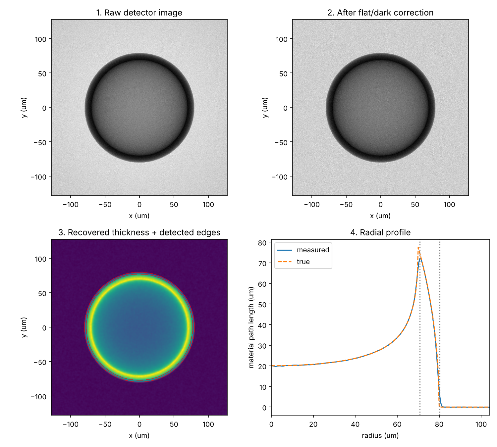

# X-ray imaging analysis of a simulated fusion target shell

A Python pipeline that simulates an X-ray radiograph of a hollow spherical
shell, similar to an inertial fusion capsule, and recovers its geometry from
noisy detector data.

## What the script does
1. Simulates a shell (outer radius 80 µm, inner radius 70 µm) and the X-ray path length through it
2. Adds detector effects: uneven beam (flat field), dark offset and photon (Poisson) noise
3. Applies flat- and dark-field correction, masking pixels with no counts in the flat field
4. Smooths the image and recovers material thickness with the Beer-Lambert law
5. Detects the shell edges with Sobel gradient filters
6. Measures inner and outer radius from the azimuthally averaged radial profile
7. Compares the measurement with the known true values

## Results (default settings: 1000 photons per pixel)
| | Measured | True |
|---|---|---|
| Inner radius | 70.8 µm | 70.0 µm |
| Outer radius | 80.2 µm | 80.0 µm |
| Shell thickness | 9.5 µm | 10.0 µm |

## Observations
- **Smoothing trade-off:** stronger Gaussian smoothing (sigma 0.5 → 5) pushed both
  detected edges outward and changed the measured shell thickness from 9.5 to
  11.0 µm. Smoothing suppresses noise but blurs sharp boundaries, so sigma has
  to be chosen with the feature size in mind.
- **Resolution limit:** shells down to about 2 µm were measured within 0.5 µm.
  A 1 µm shell was measured as 2 µm, because at 0.5 µm per pixel it spans only
  two pixels.
- **Low-dose failure and fix:** the original pipeline crashed at 10 photons per
  pixel, because pixels with no counts in the flat field caused division by
  zero. I masked those pixels, replaced them with the mean before smoothing, and
  used a NaN-safe average in the radial profile. The pipeline now works down to
  about 3 photons per pixel (15% invalid pixels) and fails at 1 photon per pixel
  (38% invalid).
- **Why noise matters less than expected:** between 30 and 10000 photons per
  pixel the measured radii did not change, because the azimuthal average
  combines thousands of pixels at each radius. The remaining 0.5 µm error comes
  from smoothing, not from noise.

## Limitations
- Simulated data with absorption contrast only
- No phase contrast or propagation effects, which dominate real XFEL images of low-Z targets
- A single, perfectly centred target with no motion blur or detector artefacts

## How to run
Requires Python with numpy, scipy and matplotlib. Run `xray_target_demo.py`
(in Spyder, press F5, or run cell by cell with Shift+Enter). The results are
printed in the console and the figure is saved as `results.png`.

Author: Savan Kanani
